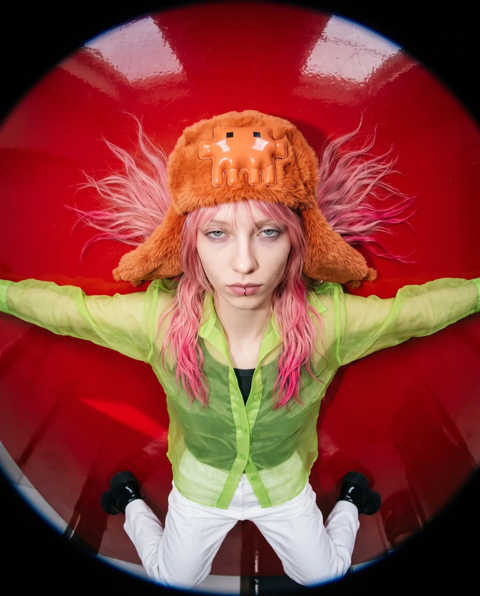
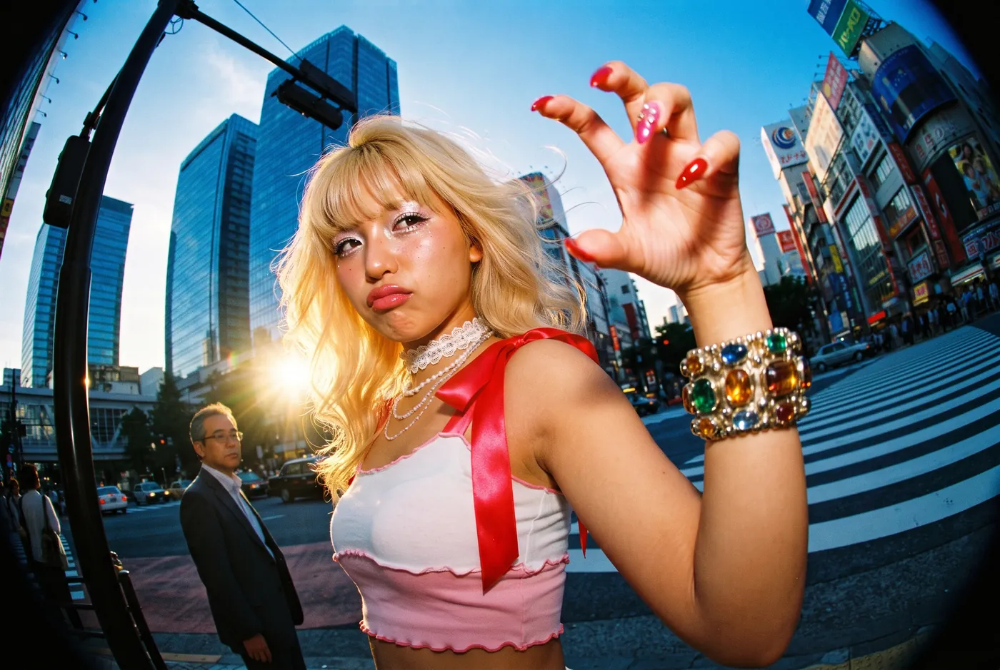
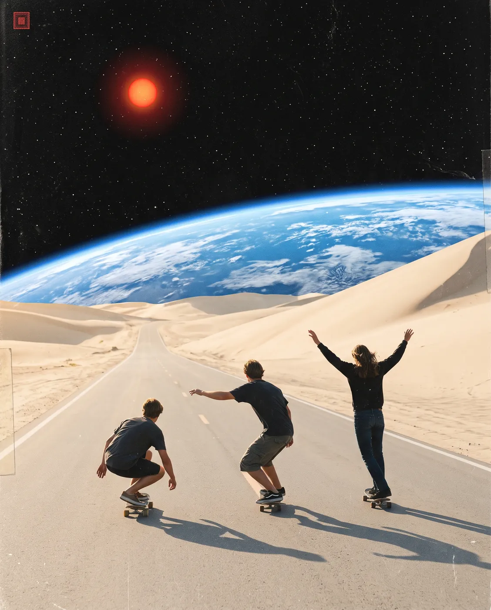
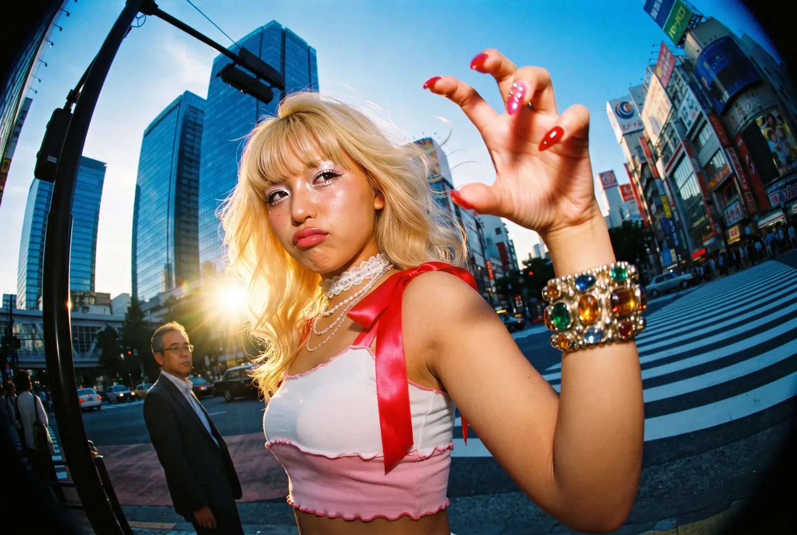

# Nano Banana Pro skill for AI coding agents

Generate and edit images with **Nano Banana Pro** from your AI coding agent, using your own Gemini web session. The agent acts as the art director: it writes the prompt, runs one script, **looks at the result** and iterates. Built and tested with Claude Code; the script is a plain command-line tool, so any agent that can run a shell command can use it (see [Works with other agents](#works-with-other-agents)).

<p align="center">
  
  
  
</p>

> **Heads up.** This drives the **unofficial** Gemini web interface through the [`gemini-webapi`](https://github.com/HanaokaYuzu/Gemini-API) library, with your own logged-in session. It is not the official API, it can break when Google changes the site, and it spends your plan's daily credits. Use it only with your own account and within Google's terms. This project is not affiliated with Google or Anthropic.

## What you get

- One script, no subagents: `scripts/nanobanana.py`.
- A skill that tells the agent how to brief, run, review and iterate.
- **Quota alerts.** The script tells the agent when you cross 50%, 25%, 10% and 5% of your daily credits, and stops cleanly when the limit is over instead of hanging for minutes.
- Model choice per image (`gemini-carbon` by default) and what we learned about each one (below).

## Install

You need Python 3.10+ and a Google account with access to Nano Banana Pro on [gemini.google.com](https://gemini.google.com).

### 1. Get the skill

```bash
git clone https://github.com/gustavo-henriq/nano-banana-pro-skill.git
cd nano-banana-pro-skill
pip install -r requirements.txt
```

Copy the skill folder where your agent looks for skills (the paths below are for Claude Code):

```bash
# macOS / Linux
cp -r skills/nano-banana-pro ~/.claude/skills/
```

```powershell
# Windows (PowerShell)
Copy-Item -Recurse skills\nano-banana-pro $HOME\.claude\skills\
```

Use `.claude/skills/` inside a project instead if you want it for that project only. Start a new session so the skill is picked up.

### 2. Give it your Gemini session (cookies)

There is no API key here. The script acts as your browser, so it needs the two cookies that prove you are logged in to Google.

1. Open [gemini.google.com](https://gemini.google.com) while logged in.
2. Open the browser developer tools (`F12`).
3. Chrome / Edge: **Application** tab, **Storage / Cookies**, pick `https://gemini.google.com` (or `.google.com`). Firefox: **Storage** tab, **Cookies**.
4. Copy the **Value** of `__Secure-1PSID` and of `__Secure-1PSIDTS`.

Then choose one place to keep them:

**A. A file (recommended).** Create `~/.nano-banana-pro/cookies.json` (on Windows: `C:\Users\<you>\.nano-banana-pro\cookies.json`). Use [`cookies.example.json`](cookies.example.json) as the template:

```json
{ "__Secure-1PSID": "...", "__Secure-1PSIDTS": "..." }
```

On the first run the script locks that folder so only your user can read it (see [Cookie security](#cookie-security)). Windows tip: make sure the file is not saved as `cookies.json.txt`.

**B. Environment variables**, if you prefer not to have a file:

```bash
export GEMINI_1PSID="..."
export GEMINI_1PSIDTS="..."
```

Check that it works without spending anything: `python skills/nano-banana-pro/scripts/nanobanana.py --quota` prints your remaining credits. The cookies expire from time to time; when they do the script exits with code 2 and you repeat the steps above.

## Works with other agents

The skill has two independent parts, and neither depends on Claude:

- **`scripts/nanobanana.py`** is a plain Python command-line tool. It takes a prompt, writes an image file and prints simple lines (`SAVED`, `QUOTA`, `LIMIT_REACHED`) with documented exit codes. Anything that can run a shell command can call it, and so can you.
- **`SKILL.md`** is a short instruction file with `name` and `description` frontmatter, a format that other agent tools also read as "skills".

How to use it with another tool:

- **The agent supports skills:** copy `skills/nano-banana-pro` into that tool's skills folder (check its documentation for the path).
- **It does not:** paste the body of `SKILL.md` into its instructions file (for example `AGENTS.md`, a rules file or a custom prompt) and tell it where the script is.
- **No agent at all:** run the script from the terminal (see [Use it](#use-it)).

The agent needs to run shell commands and read local files, and it works best if it can look at images, so it can review what it generated. I have only tested it with Claude Code; reports from other tools are welcome.

## How it works (and why it is fragile)

There is no public image API behind the Gemini app. The web page talks to Google's servers through **internal HTTP endpoints** that were never meant for third parties. The [`gemini-webapi`](https://github.com/HanaokaYuzu/Gemini-API) library reproduces what your browser does, and this skill drives it:

1. **Session.** It requests `https://gemini.google.com/app` with your cookies to obtain the per-session values the page embeds. `__Secure-1PSID` is the credential that identifies your logged-in Google session; `__Secure-1PSIDTS` is a companion that Google rotates, so the library refreshes it through `accounts.google.com/RotateCookies` and keeps a copy.
2. **Uploads.** Reference images are uploaded to `content-push.googleapis.com/upload`.
3. **Generation.** The prompt, the model choice and the uploaded references are posted to the web app's `StreamGenerate` endpoint (`.../BardChatUi/data/assistant.lamda.BardFrontendService/StreamGenerate`). The answer is a stream of **nested arrays**, not documented JSON objects.
4. **Parsing and download.** The library walks those arrays at fixed positions to find the text and the image URLs, then downloads the images with the same cookies.
5. **Account info.** Credits and limits come from Google's `batchexecute` RPC endpoint, the same call the web app uses to draw its usage meter. This is where the `QUOTA` alerts come from.

What follows from this design:

- **It can break without notice.** Nothing is versioned or promised. When Google moves a field or renames an endpoint, the library needs an update; if the script suddenly fails after weeks of working, run `pip install -U gemini-webapi` first.
- **It is your account.** Every request is made as you, and spends your plan's credits.
- **It is not an official integration.** Use it with your own account and within Google's terms; do not build a service for other people on top of it.
- **No API key, no billing page, no SLA.** The "daily limit" is simply the usage meter of your Gemini plan.

## Cookie security

The two cookies work like a password: whoever has them can act as you on your Google account until they are revoked. What this repo does about it:

- **They never live in the repo.** The default location is `~/.nano-banana-pro/`, outside any project, and `.gitignore` blocks anything named like a cookie file (`*cookies*.json`, `*cookies*.txt`, `.env`, `*.pem`, ...). Only `cookies.example.json`, with placeholder text, is tracked.
- **The folder is locked to your user.** On the first run the script restricts `~/.nano-banana-pro/`: `chmod 700/600` on macOS and Linux, and `icacls` with inheritance removed on Windows, so other accounts on the machine cannot read it. It then checks that you can still read your own files.
- **The library's cookie cache is kept in the same folder.** `gemini-webapi` stores the refreshed cookies in a cache directory, which by default is the shared system temp folder and whose file names contain your session id. The script points it to `~/.nano-banana-pro/cache` instead. If you used an older version, you can delete `%TEMP%\gemini_webapi` (or `/tmp/gemini_webapi`).
- **The script never prints them.** Output is limited to `MODEL`, `SAVED`, `QUOTA` and `LIMIT_REACHED` lines, and the library's own logging is silenced. The skill also tells the agent never to print, read aloud or commit them.
- **You should still:** never paste the cookies in a chat, an issue or a screenshot; keep the folder out of cloud-synced directories; and if they leak, sign out of all sessions or change your password at [myaccount.google.com](https://myaccount.google.com), which invalidates them.

### Troubleshooting

| Symptom | Likely cause | Fix |
|---|---|---|
| exit code `2`, "Authentication failed" | expired or wrong cookies | copy fresh values (steps above) |
| exit code `3` | missing dependency | `pip install gemini-webapi browser-cookie3` |
| exit code `4`, `LIMIT_REACHED` | daily credits are over | wait for the reset time it prints; check with `--quota` |
| exit code `5` / hangs for minutes | limit over, or Google is slow | run `--quota`; retry later |
| exit code `1`, "No image generated" | the model replied with text or refused | read the reply it prints and simplify or rephrase the prompt |
| it worked for weeks, now fails | Google changed the web app | `pip install -U gemini-webapi` |

## Use it

In your agent, just ask: *"generate a fisheye portrait of ... with these two references"*. Or run the script yourself:

```bash
# simple
python skills/nano-banana-pro/scripts/nanobanana.py "a ceramic cat lying on a city highway" -o out/cat.png --aspect 4:5

# a JSON spec with references and an explicit model
python skills/nano-banana-pro/scripts/nanobanana.py --prompt-file examples/prompts/g1_extreme_close.json \
  -o out/g1.png --aspect 4:5 --model gemini-carbon --ref pose.png --ref character.png

# how many credits are left (generates nothing)
python skills/nano-banana-pro/scripts/nanobanana.py --quota
```

| Option | What it does |
|---|---|
| `--prompt-file` | read the prompt from a file (use it for JSON and long prompts) |
| `--aspect 4:5` | aspect ratio; resolution depends on it, not on the model |
| `--ref a.png --ref b.png` | reference or edit images, repeatable |
| `--model` | `gemini-carbon` (default), `gemini-pro`, `gemini-flash`, `gemini-flash-lite` |
| `--timeout 300` | seconds to wait for the image |
| `--quota` | print the remaining credits and exit |

### Output lines

```text
MODEL gemini-carbon
SAVED /path/out/g1.png
QUOTA 48% left (1161/2400 credits), resets at 16:38  (crossed the 50% mark)
```

`QUOTA` only shows when you cross 50%, 25%, 10% or 5% left (once per mark, re-armed after each reset). If the daily limit is over you get `LIMIT_REACHED ...` and exit code 4. Exit codes: `0` ok, `1` no image or refused, `2` authentication, `3` missing dependency, `4` limit reached, `5` timeout.

## Carbon vs Flash Lite: what we found

We ran the same prompts and references on `gemini-carbon` and `gemini-flash-lite`, on about ten scenes (fisheye street portrait, studio pose, aquarium close-up, product on a cactus, carousel, glazed ceramic, vending machine, pool, skate road, flower field), plus a long character session. This is informal, not a benchmark, but the pattern was consistent.

| | `gemini-carbon` (default) | `gemini-flash-lite` |
|---|---|---|
| Geometry, perspective, camera angle | **Better.** Follows the requested lens and angle. | Often relaxes it into a "safer" framing. |
| Pose and gestures from a reference | **Better.** Reproduced a specific hand gesture and body lean. | Tends to drop the gesture and keep only the rough pose. |
| Small details of a reference | **Better.** Kept the necklace charm, lace, rings. | Simplifies the outfit and accessories. |
| Skin, material, finish | Natural, with visible texture. | **Smoother and more polished.** Won on glazed ceramic, film look and glossy retouch. |
We did not measure speed or credit cost per model, so we make no claim about them.

Rule of thumb: **use carbon for anything with a camera angle, a pose or a reference; use flash-lite when the picture is about texture and finish; for an important image, generate with both and pick.**

<table>
<tr><td align="center"><b>carbon</b></td><td align="center"><b>flash-lite</b></td></tr>
<tr>
  <td></td>
  <td></td>
</tr>
<tr><td colspan="2" align="center">Same prompt and references. Carbon reproduced the raised hand with the ring and the necklace charm; flash-lite smoothed the skin and lost the gesture.</td></tr>
<tr>
  <td></td>
  <td></td>
</tr>
<tr>
  <td></td>
  <td></td>
</tr>
<tr>
  <td></td>
  <td></td>
</tr>
</table>

More pairs are in [`examples/model-comparison`](examples/model-comparison).

## Showcase

Nine more images made with Nano Banana Pro, the kind of scenes the skill is good at: a cinematic collage, an out-of-focus flower field and its sharp version, a night pool, a giant sleeping cat, two film-style fisheye street portraits and a supermarket flash portrait. They are in [`examples/showcase`](examples/showcase).

<p align="center">
  
  
  
  
</p>

## Prompt lessons

- **JSON prompts work better** for complex scenes: format, camera, subject, clothing, background, lighting and negatives. See [`examples/prompts`](examples/prompts).
- **Numbers beat adjectives.** "Close-up" and "tight" are ignored. Say "lens about 15 cm from her face", "12mm fisheye", "hat fills 45 percent of the frame height".
- **A reference per job.** Say what each reference is for ("image 1 is only the pose, do not copy the person"). Passing every reference to every prompt mixes them.
- **Pass the pose as an image.** Describing a pose in words is weak.
- **Keep prompts focused.** Very long prompts can come back as text instead of an image; the script puts an "output only the image" instruction first.
- Ask for **what you do not want** (`negative`): freckles, scarf, extra fingers, readable text.

## Daily limit

Image generation shares your plan's daily credits (a Pro plan reported 2400). The script reads them after each run and prints a `QUOTA` line at the 50%, 25%, 10% and 5% marks, so the agent can warn you before you run out. When the limit is over, it prints `LIMIT_REACHED` with the reset time and exits. A generation that hangs for minutes is usually a sign that the limit is over: run `--quota`.

## Examples

All images in `examples/` were generated with Nano Banana Pro. Some contain incidental brand marks and characters that the model drew from the scene description (a laptop logo, drink labels, a billboard, storefront ad text, a plush hat in the style of a known mascot), and a few show the Clawd mascot, which belongs to Anthropic; that is fan art for illustration and not an endorsement. Do not publish reference photos of other people without permission.

| Folder | Content |
|---|---|
| [`examples/model-comparison`](examples/model-comparison) | the same scene on carbon and flash-lite, 10 scenes |
| [`examples/clawd-hat`](examples/clawd-hat) | a character and hat session: fisheye angles, a 3D hat render, a pose swap |
| [`examples/showcase`](examples/showcase) | nine standalone generations (collage, flowers, pool, giant cat, fisheye, flash portrait) |
| [`examples/prompts`](examples/prompts) | the JSON specs used for several of them |

## Layout

```text
skills/nano-banana-pro/
  SKILL.md             how the agent should use it
  scripts/nanobanana.py
examples/              optimized WebP examples and prompts
```

## License

MIT, see [LICENSE](LICENSE).
